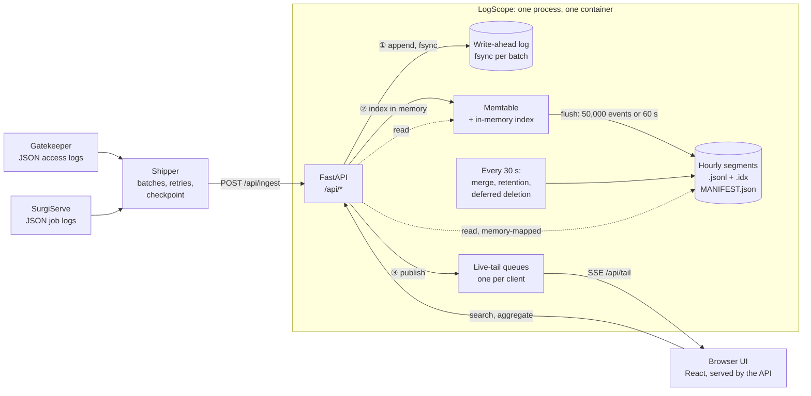

# LogScope

A log search engine, built from the storage up. Services send JSON log
lines over HTTP; LogScope writes them to an append-only write-ahead log,
organizes them into time-partitioned segment files, and answers searches
through an API and a React UI. Its first real data is the JSON logs of two
earlier projects, SurgiServe and Gatekeeper.

It deliberately does not use Elasticsearch, OpenSearch, Loki, ClickHouse or
SQLite's full-text search: the point is to build the parts they provide.

> **Status:** all 7 milestones built. Events can be ingested, survive
> crashes, and be searched with a small query language through an inverted
> index; counted over time, by value and as numbers; and followed live,
> from an API and a browser UI. A shipper sends real log files into it, and
> it has been measured on 157,452 real log lines from Gatekeeper and
> SurgiServe, on one 8 GB laptop: [Load testing](#load-testing).

## Status

| # | Milestone | Status |
|---|-----------|--------|
| 0 | Skeleton: FastAPI `/api/health`, React (Vite, JavaScript) shell served by the API, ruff + mypy --strict + pytest, ESLint + Vitest, CI, one-container Compose | Done |
| 1 | Ingestion and storage: `POST /api/ingest`, append-only write-ahead log with crash recovery, time-partitioned segments, search by time range by scanning | Done |
| 2 | Inverted index per segment; segment time bounds to skip segments; indexed results checked against the scan | Done |
| 3 | Query language (`level:error service:gatekeeper status>=500 "upstream timeout" NOT route:/healthz`), positioned errors; property test: index equals scan | Done |
| 4 | Aggregations, live tail over Server-Sent Events, retention, merging small segments | Done |
| 5 | React UI: query box, results, histogram, field sidebar, live tail | Done |
| 6 | Real logs (SurgiServe, Gatekeeper) through a shipper; measured ingest rate and query latency, index vs scan | Done (29 of 34 runs valid; [results](bench/RESULTS.md)) |
| 7 | Architecture diagram, design decisions, failures found, benchmarks; [explain-it-yourself prompts](docs/explain-it-yourself.md) | Done |

## Quickstart

Needs Docker.

```bash
make up        # build and start on :8200; waits until the health check passes
curl -X POST --data-binary @- localhost:8200/api/ingest <<'EOF'
{"time": "2026-10-06T21:00:00Z", "level": "INFO", "msg": "hello"}
EOF
curl 'localhost:8200/api/search?start=2026-10-06T00:00:00Z'
curl -G localhost:8200/api/search --data-urlencode 'q=level:info hello'
make demo      # 6,000 synthetic events over the last six hours, to try the UI
open http://localhost:8200
make down      # the data stays in a Docker volume; `make reset` deletes it
```

`make demo` loads made-up events shaped like Gatekeeper's access logs and
SurgiServe's job logs, with a burst of upstream timeouts an hour ago; they
are for trying the interface, not a measurement of anything.

`make smoke` starts a separate, empty stack on :8201, checks it over HTTP
from outside (including killing the container with SIGKILL and checking
that nothing acknowledged was lost), and deletes it.

## Architecture



What one batch of log lines goes through:

```
shipper ──► POST /api/ingest ──► parse each line (a bad one is rejected with its line number)
   ──► one WAL record, fsynced ──► memtable and its index ──► matching live tails ──► 200
later: flush ──► segment .jsonl + .idx ──► new MANIFEST.json ──► the old WAL file deleted
```

Searches and aggregations read the memtable and the segments together, so
an event is searchable as soon as it is acknowledged. Nothing is shared
between processes: a lock file allows one LogScope per data directory, and
the shipper only ever talks HTTP.

## API

**`POST /api/ingest`**: newline-delimited JSON, one event (a JSON object)
per line.

- An event's time comes from the first of `time`, `ts`, `timestamp` or
  `@timestamp` it has: an ISO 8601 string **with a time zone**, or Unix
  seconds. With none of them, it gets the time it was received.
- A bad line (not JSON, not an object, a timestamp without a time zone,
  NaN, nested over 64 levels, over 64 KiB) is rejected with its line number;
  the rest are stored. The answer lists the accepted ids and up to 100
  errors:
  `{"accepted": 2, "rejected": 1, "first_id": 1, "last_id": 2, "errors": [{"line": 2, "error": "not valid JSON: ..."}]}`
- A body over 8 MiB or 10,000 events is refused whole (413), so a client can
  split it. Whether the client declared the length or not: the body is
  counted as it is read.
- **A 200 means the accepted events are on disk** (fsynced) and survive a
  crash. If the disk fails, the answer is 503 and writes stay refused until
  a restart.

**`GET /api/search?q=&start=&end=&limit=&cursor=&index=`**: events
matching `q` with `start <= time < end` (ISO 8601 with a time zone; both
optional), newest first, at most `limit` (1-1000, default 100). Pass
`next_cursor` back as `cursor` for the next page. `index=false` scans every
event instead (the baseline). The answer shows the query as it was
understood, with its grouping explicit (`a OR b c` comes back as
`a OR (b c)`), and says how many segments were read or skipped, how many
events were read, and how many had to be checked against the query.

A bad query is a 422 that says what is wrong and where:
`{"detail": {"error": "this ( is never closed", "position": 12}}`.

### The query language

```
level:error service:gatekeeper status>=500 "upstream timeout" NOT route:/healthz
```

| Term | Matches |
|------|---------|
| `field:value` | the field's whole value, case-insensitively: `level:error` finds "ERROR". Numbers match by value, whether written as numbers or as numeric strings: `status:503` finds 503, 503.0, "503" and "503.0" |
| `field:"a value"` | the same, quoted for spaces or `( ) "`: `route:"GET /users/{id}"` |
| `field:*` | the field is present (also an enclosing object: `http:*`) |
| `field>=N`, `>N`, `<=N`, `<N` | a numeric range, over numbers and numeric strings |
| `word` | the word anywhere in the event; `3f2a-77` (several parts) is a phrase |
| `"a phrase"` | the words, consecutively, within one value |

Combined, tightest first: `NOT x`; `x y` or `x AND y` (both); `x OR y`
(either); parentheses to group. `AND`, `OR` and `NOT` are operators only in
capitals: "not" is a word. Nested fields use dots (`http.method`); an
array's elements count as the array's field. The timestamp fields are
searched with `start` and `end`, not in `q`.

### Aggregations

All four take `q`, `start` and `end` like a search, count every matching
event (not a page), and say what they read.

**`GET /api/aggregate/histogram?interval=`**: matching events per time
bucket (`30s`, `5m`, `1h`, `1d`; by default the smallest of a list of round
widths giving at most about 60 buckets, over the stored range when `start`
and `end` are left out; at most 2,000 buckets).

**`GET /api/aggregate/terms?field=&size=`**: a field's most frequent values
among the matching events, with how many matched and how many had the
field. Values group the way queries match them, so the count shown for
`503` is exactly what `status:503` finds (503, 503.0 and "503" are one
value; "ERROR" and "error" are one).

**`GET /api/aggregate/fields?size=`**: the fields the matching events have
(nested ones by dotted path, and their enclosing objects), with how many
events have each.

**`GET /api/aggregate/numeric?field=`**: count, min, max, mean and the 50th,
90th, 95th and 99th percentiles (nearest rank, exact) of a field's numbers,
including numeric strings.

### Live tail

**`GET /api/tail?q=`**: Server-Sent Events: each newly stored event that
matches `q`, as `event: event` with its id, time and body, in the order they
arrive (not by time). Nothing stored before the connection is replayed. A
comment every 15 s keeps an idle connection open. A client that cannot keep
up gets `event: dropped` with how many events it missed, rather than the
server buffering without limit; when the server shuts down, `event: end`.

**`GET /api/stats`**: events in memory and in segments, WAL files, files
waiting to be deleted, the retention period, whether writes are accepted.

**`GET /api/health`**: liveness only.

## Shipping logs

`python -m logscope.ship` follows a log file (or reads standard input) and
posts it to `/api/ingest` in batches (1,000 lines, 1 MiB, or after 1 s,
whichever comes first):

```bash
python -m logscope.ship --file /var/log/app.jsonl --checkpoint app.ckpt
docker compose logs --no-log-prefix -f gatekeeper | python -m logscope.ship
```

What it promises: **every line is delivered at least once.**

- Network errors, timeouts, 429s and 5xx (LogScope's 503 when its disk
  fails) are retried with exponential backoff and jitter until they succeed;
  a stop signal ends the wait, leaving the batch for the next run.
- A 413 splits the batch in half, recursively; a single line too big for any
  request is counted as rejected, so it cannot stop the shipper for good.
- Lines the server rejects are counted and reported, not retried.
- A line that is not a JSON object (a startup message, a Go panic) is sent
  as `{"message": <line>, "unparsed": true}` rather than lost.
- With `--file`, it follows the file through growth, rotation (a new inode)
  and truncation, sends a line only once it is complete, and checkpoints the
  offset after each delivered batch. Delivery, then checkpoint: a crash
  between the two resends one batch, never skips one.

Tested against a scripted server (each failure above) and, end to end, as a
separate process against a real LogScope: a rerun from the checkpoint sends
nothing twice, and a shipper SIGKILLed mid-file and restarted delivers every
line, duplicating at most one batch.

## The interface

One page: a query bar, a timeline of matching events, the fields those
events have, and the events themselves.

- **The timeline is a strip-chart recording.** It is drawn on engineering
  paper whose fine vertical rules are the bucket boundaries, so the paper
  itself shows how time is divided. Hover or focus a bar for its count and
  time span; click a bar, or drag across several, to zoom in; arrow keys
  read the bars one by one and Enter zooms; every count is also available
  as a table.
- **A bad query is pointed at:** the query is repeated with a caret under
  the character the error is about. When the server groups a query
  differently from how it was typed (`a OR b c`), the reading is shown
  (`a OR (b c)`).
- **Fields** lists the fields the matching events have, most common first;
  opening one shows its top values with bars, and for numbers the min,
  median, 99th percentile and max. Every value, there or in an opened
  event, can be added to the query or excluded from it, written the way the
  query language reads it (quoted when needed; an existing `OR` is put in
  parentheses first, since `AND` binds tighter).
- **Events** are one dense line each (time, level, service, message, the
  other fields); one click opens the whole event as JSON.
- **Follow live** opens the live tail for the current query; new events
  arrive at the top, marked. A client that falls behind is told how many
  events it missed.
- The query and time range live in the URL, so a view can be bookmarked or
  shared; while a new search loads, the last results stay, dimmed.

Built with React and plain CSS, no component or chart library. Three
typefaces, bundled rather than fetched from a font service, so a
self-hosted log tool makes no requests to anyone else: Martian Mono for
small labels, Instrument Sans for the interface, Fragment Mono for queries
and log lines (with ligatures off, so `>=` shows as typed). The chart's blue
was checked for contrast and lightness against both the light and the dark
recorder paper; level icons use reserved status colors and always come
with the level's name. Dark mode follows the system.

## How storage works

```
POST /api/ingest
   │  one record per batch: "LSW1" | length | CRC-32 | JSON
   ▼
 wal/00000000000000000123.wal ── fsync ──► 200 OK
   │
   ▼
 memtable (in memory, searchable at once)
   │  flush: 50,000 events, or the oldest has waited 60 s
   ▼
 segments/2026-10-06T21/…-….jsonl   one file per hour per flush,
                    …-….idx     with its index
 MANIFEST.json                      which segments exist, and "flushed through" id
```

- **Every batch is one WAL record**, written and fsynced before the 200. The
  next record is written only after that, so a crash can damage only the
  last record, which was never acknowledged: recovery cuts that *torn tail*
  off.
- **A damaged record with a good one after it is not a crash** (acknowledged
  data was damaged), so recovery refuses to start and says where, rather
  than skipping it.
- **The manifest is the commit point of a flush.** Segment files are
  written first, then a new manifest names them and the highest id they
  hold; only then are old WAL files deleted. A crash before the manifest
  leaves orphan segment files, deleted on start, and the WAL still has the
  events; a crash after it leaves WAL records that recovery skips.
- **Ids are global and contiguous,** so recovery can check that every id is
  in a segment or the WAL. A gap is reported, not skipped.
- **Every file that matters is replaced atomically:** written under a
  temporary name, fsynced, renamed, and its directory fsynced.
- **One process per data directory,** enforced with a lock file; a second
  one refuses to start.
- **After a failed fsync, writes stop.** The kernel may have dropped the
  unwritten pages and cleared the error, so a retry could "succeed" without
  the data on disk (PostgreSQL's "fsyncgate"). The partial record is cut
  off, and ingest answers 503 until a restart.

### Merging, retention, and when files are deleted

Every 30 seconds, in the background:

- **Retention** (`LOGSCOPE_RETENTION_HOURS`, off by default) drops segments
  whose events are all older than the period. Ingest refuses events already
  past it, rather than storing what the next pass would delete.
- **Merging**: an hour with 8 or more segments (a flush every minute makes
  60 an hour) is merged into one: a k-way merge of the already sorted
  segments, the lines copied as they are, and a new index. Each merge of a
  busy hour rewrites what that hour holds so far; a size-tiered policy would
  write less, at the cost of more segments to search.
- Both commit by writing a new manifest, like a flush. **The old files are
  deleted only when no running search can still need them.** Every
  manifest change is a new version; a search records the version it
  started from; a file dropped at version *v* is deleted once every running
  search started at *v* or later. Deleting at once would break a search
  already part-way through: skipping a merged-away file would silently miss
  its events, which now live in a segment that search never saw.
- **New segment files are numbered** (`00000012-<first id>-<last id>`), and
  numbers are never reused. Two merges of one hour can cover the same ids;
  named by ids alone, the second would overwrite a file the manifest still
  lists.

## How search works

```
segments, newest first ──► outside the time range? skip
        │                  older than the top `limit` found so far? stop
        ▼
 segment index (.idx, memory-mapped)
   times + ids of every row ──► binary search: the rows in the time range
   term directory (sorted)  ──► binary search: a term's rows, or (ranges)
        │                       the run of one field's values
        │  the query tree, bottom up: candidate rows + "exact or not"
        ▼
 candidates, newest first ──► read the row ──► not exact? check it
                                               against the query
```

- **One function decides what an event contains,** `terms_of`, and both the
  index and the full scan use it. So they cannot disagree about what
  matches; only the index's machinery (writing, binary search,
  intersecting, stopping early) can be wrong, and that is what the tests
  compare with the scan.
- **Rows in a segment are sorted by (time, id),** and the index keeps each
  row's time and id. A search orders and filters rows without reading
  them, reads only the ones it returns, and stops once nothing older can
  make the top `limit`.
- **The index narrows; it does not have to decide.** Each part of a query
  gives a set of candidate rows that contains every match, and says
  whether it is exact. Most terms are exact. A phrase is not: the index
  knows its words are in a row, not that they are consecutive. That
  carries up the tree: `NOT` of something inexact cannot be a complement,
  so every row becomes a candidate; `AND` and `OR` are exact only if all
  their parts are. Inexact candidates are checked against the event with
  the same function the full scan uses.
- **Events still in memory** have their own in-memory index, so a search
  sees them at once, including those being flushed.
- **Ranges walk one field's values:** the directory is sorted, so a field's
  terms are one run, found by bisection, and each value is compared. A
  field with mostly distinct values (durations) makes that run as long as
  the segment, which makes ranges over such fields the slowest kind of
  query; a sorted numeric column per field would fix it.
- **Not indexed:** the timestamp fields (the time range covers them), and
  string values over 256 characters as exact values (they are still
  indexed word by word; asking for one exactly is refused, not missed).

### How it is tested

- Every byte position: the last WAL record is cut at each one, and recovery
  must keep exactly the records before it.
- Crashes injected at each step of a flush (before the manifest, after it
  but before the WAL cleanup), a failed flush followed by a good one, a
  missing record in the middle of the WAL, a second process, a failed fsync.
- **SIGKILL of a real process** while it ingests and flushes constantly:
  every batch it acknowledged must be there after recovery, once, with no
  gap in the ids; four kill-and-recover rounds per test. A one-off run of
  160 kills (40 seeds) lost and duplicated nothing.
- The smoke test SIGKILLs the container itself and checks that an event
  held only in the WAL comes back.
- **The SIGKILL test merges too:** the killed process merges any hour with
  two segments, continuously, so kills land mid-merge; the test fails if no
  merge finished, so it cannot quietly stop testing them. A one-off run of
  80 more kills (20 seeds) with merging lost and duplicated nothing.
- Crashes before and after a merge's manifest; two merges of one hour; a
  merge in the middle of an aggregation, whose old files must stay readable
  until it finishes and be deleted after; retention's exact cutoff.
- **Aggregations against the scan:** for random queries and time ranges,
  every histogram bucket holds exactly the events the scan finds in it;
  every top value's count is exactly what searching for that value finds;
  numeric stats equal those of the scanned events. Six planted bugs (a
  bucket edge, an off-by-one in counting, values not grouped by number,
  events outside the time range, unchecked phrase candidates, every
  spelling of a number counted) each make them fail.
- **The interface** (Vitest and Testing Library, 31 tests): adding a filter
  to a query (quoting, grouping an `OR`); the timeline's bars, keyboard
  reading, drag-to-zoom and table; the whole page against a fake API (the
  view from the URL, a search landing in the URL, a bad query's caret, the
  field values and the event JSON filtering, live events arriving through a
  fake EventSource, the API not answering). Then checked in a real browser,
  light and dark, at desktop and phone width.
- **The live tail against a real server** (uvicorn in a thread): new
  matching events arrive and others do not; keep-alives; a client hanging
  up is unsubscribed; a SIGTERM ends open tails at once and the memtable is
  still flushed; and, to show why that matters, with uvicorn's default an
  open tail keeps the server running after it was asked to stop.
- **The index against the scan:** Hypothesis generates 600 combinations of
  a random query tree (AND, OR, NOT, phrases, ranges, fields that exist),
  time range, limit and cursor over a store whose segments overlap in time
  (late events), with some events still in memory; the index must return
  the same events in the same order as the full scan. Ten deliberately
  planted bugs (a tie-break, both ends of the time range, a union, the
  reading order, and five in how exactness combines) each make it fail.
- **The parser:** precedence, every term, 16 errors with their exact
  positions, and a Hypothesis property: any query, shown back and parsed
  again, gives the same tree.
- A search during a flush, with events both in the memtable being flushed
  and in the new one.

What is **not** tested: power loss. A SIGKILL leaves the operating system's
page cache intact; a power cut does not. On macOS, `fsync` does not even
flush the drive's cache (`F_FULLFSYNC` does); in the Docker image the
fsync goes to Linux, then through Docker Desktop's virtual disk.

## Load testing

Measured on 2026-10-07, on one MacBook Air M2 with 8 GB, Docker Desktop,
the shipper and query client on the same laptop: **a laptop, not a server
benchmark.** Full write-up, with everything it does not show:
[bench/RESULTS.md](bench/RESULTS.md).

- **Ingest:** one shipper, one batch at a time, sent the 157,452 lines at
  12,716 to 13,571 events/s in batches of 1,000 or more (10,938/s in
  batches of 100, one valid run), every batch fsynced before it was
  answered. Per-event work sets the rate, not per-batch.
- **Search, with the index vs the full scan:** 0.26 to 6.1 ms against 0.6 to
  3.7 s, for the newest 100 matches, over the 7 searches whose runs all
  passed the swap check; the same number of results both ways. The scan is
  LogScope's own Milestone 1 search, not another product.
- **What the index costs follows how common the value is:** `request_id`
  0.26 ms, `status:504` 1.3 ms, `level:info` (99% of events) 3 to 4.5 ms,
  and a range over 8,937 distinct durations 6 ms, although each returns at
  most 100 events. Each term's postings become a full set before the
  newest 100 are chosen.
- **The UI's aggregations** (timeline, field list, top values) took 0.05 to
  0.13 ms on the server, from the index alone.
- **Not reported:** four searches (field and range, `NOT`, both SurgiServe
  queries), each with a run that swapped in 51 to 645 MB, and one ingest
  run. A first full run's query timings were all invalid and are not used
  (failure 12). A trial before that was deleted.

### The logs

`make capture` runs the two earlier projects from their own repositories,
under traffic sent from here, and saves their containers' logs outside the
repository (`~/.cache/logscope-bench/corpus`, with a manifest of counts and
SHA-256):

- **Gatekeeper** (both replicas, Redis rate limiting): 150,000 requests that
  exercise what a gateway does: proxied requests (most, each with its own
  API key), a hammered key, unknown paths, wrong methods, an offline
  backend, a backend slower than its timeout. They came back 200 (126,488),
  429 (13,083), 404 (4,497), 502 (2,947), 504 (1,557) and 405 (1,428), and
  Gatekeeper wrote 151,836 log lines.
- **SurgiServe** (API and a worker): 1,500 requests (uploads, some bad, and
  lookups of missing jobs), 5,616 log lines. The worker ran with
  `SURGISERVE_MODEL=fake`: SurgiServe's real logs, but no real inference.

157,452 lines, 50 MB, every one a JSON object.

**Something the real logs showed straight away:** Gatekeeper logs every
request at INFO, its 502s and 504s included (only "instance ejected" is
WARN), so a search for `level:error` finds none of its failures; they are
found by `status>=500`. A choice in Gatekeeper's access log, not a LogScope
bug, but the kind of thing a log search exists to show.

### The method

`make bench` runs LogScope as its own Compose project with the client in
the same network (no Docker Desktop port forwarding in the numbers):

- **Ingest:** the whole corpus, sent by the real shipper into an empty store
  at batch sizes of 100, 1,000 and 5,000 lines, a fresh volume each time;
  events per second by the shipper's clock.
- **Queries:** the corpus loaded once, the store restarted (so everything is
  in segments) and given a maintenance pass; then 11 searches built from the
  corpus itself (a real request id, the offline backend's real error
  text), each repeated with the index and as the full scan, alternately,
  plus the three aggregations behind the UI. Latency is the server's own
  measure, with the client's wall time beside it.
- **Discipline, as in SurgiServe's and Gatekeeper's benchmarks:** two passes,
  the second in reverse order; it refuses to start while the host is
  swapping, and marks any run (one ingest, or one query's repetitions)
  with over 50 MB swapped in invalid.

## Development

Needs Python 3.14 and Node 20.19 or newer.

```bash
make install   # .venv with the API and dev tools; the UI's node_modules
make check     # ruff, mypy --strict, pytest, ESLint, Vitest, UI build
make dev-api   # API on :8000, reloading on changes
make dev-ui    # UI on :5173, forwarding /api to :8000
```

## Layout

| Path | What |
|------|------|
| `src/logscope/app.py` | The FastAPI app: the API under `/api`, and the built UI |
| `src/logscope/serve.py` | Running uvicorn; ending live tails as soon as a shutdown signal arrives |
| `src/logscope/settings.py` | Configuration from `LOGSCOPE_*` environment variables |
| `src/logscope/healthcheck.py` | Docker's health check (the image has no curl) |
| `src/logscope/events.py` | Parsing a line into an event; timestamps |
| `src/logscope/ingest.py` | Splitting a request body into lines; per-line errors |
| `src/logscope/wal.py` | The write-ahead log: record format, torn-tail detection |
| `src/logscope/store.py` | Memtable, flushes, segments, manifest, recovery, merging, retention, search |
| `src/logscope/terms.py` | What an event is indexed under (`terms_of`) |
| `src/logscope/query.py` | The query language: lexer, parser, positioned errors; matching one event |
| `src/logscope/index.py` | Segment index files (build, memory-mapped lookup); the in-memory index; evaluating a query to candidates |
| `src/logscope/aggregate.py` | Histogram, top values, fields and numeric stats, from the index |
| `src/logscope/ship.py` | The shipper |
| `ui/src/App.jsx` | The page: loading, the URL, live events |
| `ui/src/components/` | Query bar, timeline, fields, results |
| `ui/src/lib/` | The API client, query editing, time ranges, the live tail |
| `tests/test_wal.py`, `tests/test_store.py` | WAL records and torn tails; flushes, recovery, injected crashes |
| `tests/test_crash.py` | The SIGKILL test, with merges |
| `tests/test_search.py` | The index against the scan (Hypothesis) |
| `tests/test_query.py` | The parser, its errors, and matching |
| `tests/test_aggregate.py` | Aggregations against the scan (Hypothesis) |
| `tests/test_maintenance.py` | Merging, retention, deferred deletion |
| `tests/test_tail.py` | The live tail against a real uvicorn server |
| `tests/test_ship.py` | The shipper: failures, following files, a SIGKILL mid-file |
| `bench/capture.py` | Captures real Gatekeeper and SurgiServe logs (`make capture`) |
| `bench/run.py`, `bench/client.py` | The benchmark (`make bench`); raw results in `bench/results/`, written up in `bench/RESULTS.md` |
| `scripts/smoke.sh` | Checks a running stack over HTTP, including a SIGKILL |
| `scripts/demo_data.py` | Synthetic demo events (`make demo`) |
| `docs/explain-it-yourself.md` | Questions to answer, unaided, before LogScope goes on a resume |

## Design decisions

| Decision | Why | Cost, or what would change it |
|----------|-----|-------------------------------|
| Build the storage and the index; no search engine underneath | The point is to build what Elasticsearch or Loki provide | Far fewer features than they have, and nothing tuned like them |
| One WAL record per batch, fsynced before the 200 | A 200 means "on disk"; a crash can damage only the last record, which was never acknowledged | One fsync per request: small batches pay for it (see [Load testing](#load-testing)) |
| A damaged record before a good one stops startup | That is acknowledged data damaged, not a crash; skipping it would lose it silently | Someone has to look before LogScope starts again |
| Writes stop after a failed fsync | The kernel may have dropped the pages and cleared the error, so a retry could "succeed" without the data ("fsyncgate") | Ingest answers 503 until a restart |
| Global, contiguous event ids | Recovery can prove that nothing is missing or duplicated | One counter; an id says nothing about an event's time |
| The manifest is the commit point, replaced atomically | A crash at any step leaves the old state or the new one, never a mix | An extra fsynced file per flush or merge |
| Hourly segments, rows sorted by (time, id) | A time range skips whole files; a search stops once nothing older can make the page | Frequent flushes make many small files, hence merging |
| JSON lines beside a binary, memory-mapped index | The data stays readable by eye; the index opens without parsing | Two files per segment; reading an event means parsing its JSON |
| One function, `terms_of`, for the index and the scan | They cannot disagree about what an event contains, so the tests compare only the index's machinery | A bug in `terms_of` itself is invisible to the index-versus-scan test |
| The index narrows; inexact candidates are checked against the event | The index knows a phrase's words are in a row, not that they are consecutive | `NOT "a phrase"` checks every row in the time range |
| Each term's rows become a full set before the newest are picked | Simple, and exact for `AND`, `OR` and `NOT` | A common value costs its whole list even for 100 results: `level:info` 3 to 4.5 ms against 0.3 ms for one request id ([measured](bench/RESULTS.md)) |
| A range walks its field's run of the sorted term directory | No extra structure per field | Slowest over mostly distinct values (6 ms for 8,937 durations); a sorted numeric column per field would fix it |
| Values match case-insensitively, numbers by value | `level:info` finds Gatekeeper's "INFO" and SurgiServe's "info"; `status:503` finds 503, 503.0 and "503" | Only JSON's number syntax is a number: `code:007` is the string "007", not 7 |
| Operators only in capitals; `status:>=500` is an error | "not" and "or" are common in log messages; the other would silently be an exact match on ">=500" | A lowercase `not` is searched as a word, which can surprise; `status:>=500` at least gets an error saying what to write |
| Aggregations read the index, not the events | A histogram with no query is two binary searches per bucket; a value's count is one postings list | With a query, they pay the same full-set cost as search, and cannot stop early |
| Merge an hour once it has 8 segments, into one | Bounds the files a search opens | Each merge rewrites the hour so far; a size-tiered policy would write less and leave more files |
| Delete old files only when no running search needs them | Deleting at once would make a running search silently miss merged-away events | Files linger while long searches run |
| Retention off by default; ingest refuses events already past it | Deleting logs should be a choice; storing what the next pass deletes is pointless | The disk grows until retention is set |
| A bounded queue per live-tail client, and `dropped` when it fills | A slow client cannot make the server buffer without limit | A slow client misses events (and is told how many) |
| A SIGTERM ends open tails; `stop_grace_period: 15s` | uvicorn waits for open responses before shutting down, and here Compose sent SIGKILL after about a second | Tail clients reconnect after every restart |
| Live-tail matching in the event loop | Simple, and fine for a few clients | Many clients at a high ingest rate would want it off the loop |
| Timestamps without a time zone are rejected | Guessing UTC would misplace a local-time log by hours | Every sender must include a zone |
| Bad lines rejected one by one; an oversized batch whole (413) | Retrying will not fix a bad line; a big batch can be split | Clients handle two kinds of error |
| The shipper delivers at least once, checkpointing after delivery | A crash resends one batch, never skips one | Duplicates are possible: at most one batch per crash (tested) |
| The shipper wraps lines that are not JSON objects | A startup message or a Go panic is evidence; dropping it loses it | A wrapped line has only its text to search |
| One container: the UI built in a Node stage, served by the API at explicit routes | One thing to run; a static mount at `/` answered wrong-method API calls with the wrong status | The API also serves static files |
| React in JavaScript, no component or chart library, fonts bundled | TypeScript is not yet a language I can write and explain unaided; a self-hosted log tool should make no outside requests | The timeline is hand-built code to maintain |
| Benchmark: the scan as the baseline, the client inside the Compose network, a swap check per run | Compares LogScope with and without its index, with no port forwarding in the numbers, and drops runs a swapping laptop spoiled | Not a comparison with other products; on this 8 GB laptop some runs are always lost |

## Failures found while building it

1. **One deeply nested event would have broken search.** Pydantic cannot
   serialize past about 255 levels, so a single event nested deeper would
   make every search that returned it a 500. Found by checking before the
   API existed; ingest now rejects nesting over 64 levels, and a test
   searches an event at the limit.
2. **The editable install silently did nothing.** In an iCloud-synced
   folder, macOS marks everything inside `.venv` hidden (it comes back
   within a second of clearing it), and Python 3.13+ skips hidden `.pth`
   files, so `import logscope` failed outside pytest. `make dev-api` passes
   `--app-dir src` instead.
3. **The smoke test could not run twice.** Its data volume outlived it, so a
   second run found the first run's events. It now runs as its own Compose
   project with its own volume, deleted afterwards, so it never touches the
   data of `make up` either.
4. **The test comparing the index with the scan caught nothing.** It passed
   400 generated cases, and still passed with each of three bugs planted on
   purpose. Its data could not reach them: events were spread over 21,600
   seconds, so equal times at segment edges almost never happened; few sat
   exactly on a range boundary; and no query value had two spellings. With
   times on a 5-minute grid and values like `503.0`, all five planted bugs
   now fail it. It happened again with the query language: a planted bug
   in how `OR` treats an inexact part survived, because random queries
   rarely put `NOT "a phrase"` inside an `OR`. Phrases are now half the
   generated terms, and six such shapes run every time.
5. **`status:503` and `status>=503` disagreed about "503.0".** Ranges read
   strings that are numbers as numbers; exact matches compared spellings.
   A test of one event against both caught it; a string that is a number
   now also gets its number's index key, so the two agree.
6. **`docker compose stop` killed LogScope before it could flush.** With a
   live tail open, a clean restart lost the shutdown flush (the events came
   back only by WAL replay). Two causes, both found by the smoke test: a
   tail never ends, and uvicorn waits for open responses before running
   the app's shutdown; and on this machine (Docker Desktop, Compose v5.0.2)
   `docker compose stop` sent SIGKILL after about a second, not Docker's
   usual ten (exit 137, checked by hand). Now a SIGTERM ends open tails at
   once, uvicorn cuts off anything else after 5 s, and `compose.yaml` sets
   `stop_grace_period: 15s` rather than relying on a default.
7. **The SIGKILL test had stopped testing merges.** It ran with merging on,
   but each run was killed after a tenth of a second, before any merge
   finished, and it passed anyway. A new check that merges really happened
   failed at once; with a lower threshold and longer runs, they do.
8. **The interface said things about the wrong query.** Looking at it in a
   browser: while a new search loaded, "Read as" still showed how the
   previous query had been read, under the new one; and after a bad query,
   the old results stayed with nothing saying they were old. Now the
   reading appears only for the query on screen, and the error says whose
   results are below. A test holds a search open to check the first.
9. **The time axis repeated itself, or said nothing.** Ticks every 90 s
   labelled in minutes read "10:30, 10:30, 10:31" (seen in a screenshot),
   and for an interval no round step is a multiple of, such as 7 s, the
   first round step was a week, so the axis had no labels at all (caught by
   a unit test). Ticks now sit on round times within the span, or every
   n-th bar.
10. **The SIGKILL test of the shipper could not catch the bug it was
    for.** Checkpointing before delivering (which loses a batch if the
    shipper dies in between) was planted on purpose, and the test still
    passed three times out of three: a kill at a random moment almost never
    lands in the milliseconds of a local request. A test that makes the
    sender die on its third batch, and checks the checkpoint covers only
    the first two, catches it.
11. **The benchmark's logs were being uploaded to iCloud.** 100 MB of
    captured logs went into the repository folder, which sits in an
    iCloud-synced Documents folder; iCloud's sync processes took over a CPU
    core uploading them. `.gitignore` does not stop iCloud. The corpus now
    lives in `~/.cache/logscope-bench`, which is not synced.
12. **The benchmark's swap check could never pass.** It covered a whole
    query pass, about 3 minutes, against a 50 MB limit taken from the
    earlier benchmarks' 15-second runs, and this laptop swaps in about
    50 MB a minute at idle. The first full run's ingest passed and both
    query passes failed. The check now covers one query at a time; that
    change came after seeing the failure, so the failed run is kept,
    labelled, and the whole benchmark was run again rather than its numbers
    relabelled.
13. **The "5,000-line" batches were 3,200 lines.** The benchmark labelled
    each ingest run by the shipper's `--batch-events` setting, but the
    shipper also caps a batch at 1 MiB, and at 320 bytes a line that cap
    came first. It showed only when the write-up put the number of batches
    sent (49, not 32) beside the label. The results say so, and the runner
    now records the lines per batch actually sent.
